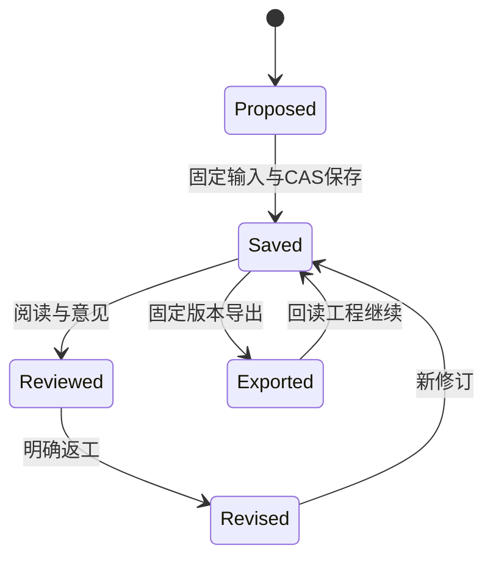

# 领域与本体设计

## 领域边界

本包是创作与线下试玩记录工具，不是线上游戏服务器或独立权限系统。玩家投影只返回选定角色可见资料；作者仍可使用主持视角。模拟试玩明确agent_simulated，不冒充真人反馈。发放只记录，不发送消息。正式人物、正文采纳和定稿归宿主；泄漏结构检查不判断文本自身是否暗示真相。

| Owner | 拥有的事实 |
| --- | --- |
| 河图Core | WorkRef、固定来源、专业对象修订、CAS、原操作、正式正文及作者决定 |
| 本插件 | 专业结构、计算、专业偏好、视图与可再生成导出 |
| 外部Agent | 理解、规划、内容生成与方法执行 |
| 作者 | 取舍、采纳、定稿、内容外发和费用决定 |

## 核心本体

| 对象 | 存储集合 | 创作含义 |
| --- | --- | --- |
| role | roles | 角色资料 |
| act | acts | 分幕 |
| clue | clues | 线索 |

所有局部ID只在当前专业工程中有意义；同名、同ID或相同版本号不能跨作品推定身份。引用正文时固定UTF-8字节区间与原引文；引用媒体时固定宿主素材修订和摘要。

## 关系与不变量

project 1—N role；project 1—N act 1—N clue；clue N—N role；project 1—N session；session 1—N append event；session N—1 fixed author revision。

每个集合ID唯一，外键必须存在；删除仍被使用的对象拒绝保存。全对象更新与细粒度动作遵循同一校验，不存在绕过领域规则的编辑入口。来源更新先说明影响，再明确建立新修订。专业选中状态不扩大成宿主选用或作者定稿。

## 领域推断的证据边界

玩家资料不包含主持解答、他人秘密、未来线索或全工程JSON

必发线索缺失阻止推进，明确跳过必须留原因

试玩保留固定作者基线，工程改稿不重写旧试玩

历史只能通过专业动作追加，保存JSON不能伪造或改写历史

模拟与真人记录明确区分，重复发放、越幕、结束后写入拒绝

## 专业对象状态

此状态图描述工作旅程，不新增重复的数据库状态机。正文采纳与定稿由宿主另行处理。

## 完整创作扩展

可选depth.version=1持有facts、briefings、deductions、clue_rules、rounds、endings、reviews与test_runs。原角色、幕次、线索及旧sessions保持；新机制测本固定完整作者快照与只追加事件，规则及实体关系见[10](10-完整创作与机制测本.md)。
