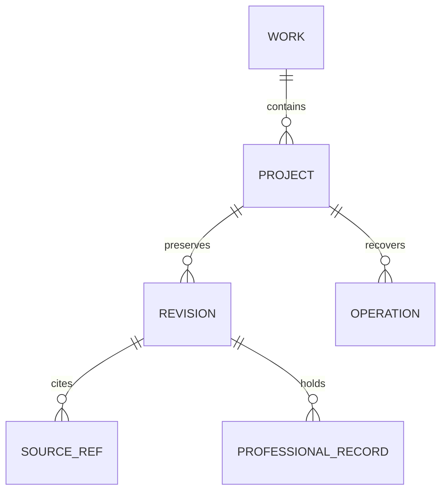
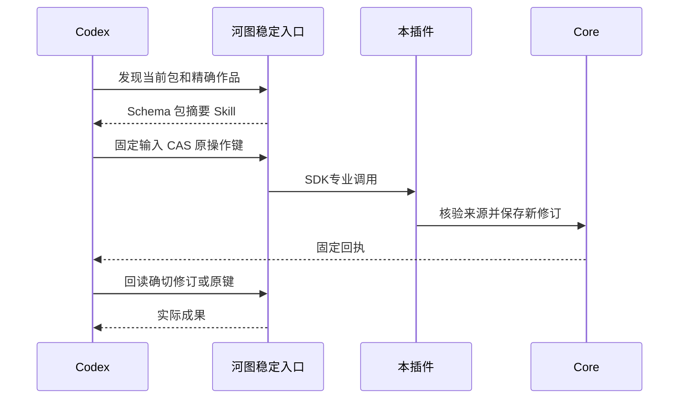

# 数据与API设计

## 数据格式

唯一可执行Schema是[包清单](../contracts/plugin-manifest.json)，`additionalProperties=false`拒绝拼错字段。`format_version=1`，Schema版本`1.0.0`；升级不得裁掉新字段覆盖旧数据。

| 根字段 | 类型 | 必填 |
| --- | --- | --- |
| format_version | constant | 是 |
| title | string | 是 |
| basis_refs | array | 是 |
| premise | string | 是 |
| gm_notes | string | 是 |
| solution | string | 是 |
| sessions | array | 是 |
| roles | array | 是 |
| acts | array | 是 |
| clues | array | 是 |
| depth | object，version=1 | 否 |

### 角色资料 `roles`

| 字段 | 类型／范围 |
| --- | --- |
| id | `{"type":"string","maxLength":100,"minLength":1}` |
| name | `{"type":"string","maxLength":200,"minLength":1}` |
| public_profile | `{"type":"string","maxLength":8000,"minLength":0}` |
| private_brief | `{"type":"string","maxLength":16000,"minLength":0}` |
| entity_ref | `{"anyOf":[{"type":"string","maxLength":100,"minLength":1},{"type":"null"}]}` |
| entity_source_index | `{"anyOf":[{"type":"integer","minimum":0,"maximum":99},{"type":"null"}]}` |

### 分幕 `acts`

| 字段 | 类型／范围 |
| --- | --- |
| id | `{"type":"string","maxLength":100,"minLength":1}` |
| title | `{"type":"string","maxLength":200,"minLength":1}` |
| order | `{"type":"integer","minimum":1,"maximum":20}` |
| public_brief | `{"type":"string","maxLength":8000,"minLength":0}` |
| gm_notes | `{"type":"string","maxLength":8000,"minLength":0}` |

### 线索 `clues`

| 字段 | 类型／范围 |
| --- | --- |
| id | `{"type":"string","maxLength":100,"minLength":1}` |
| title | `{"type":"string","maxLength":200,"minLength":1}` |
| text | `{"type":"string","maxLength":8000,"minLength":1}` |
| act_id | `{"type":"string","maxLength":100,"minLength":1}` |
| audience | `{"enum":["public","private"]}` |
| role_ids | `{"type":"array","items":{"type":"string","maxLength":100,"minLength":1},"maxItems":20}` |
| required | `{"type":"boolean"}` |

## 数据库与持久化

本包不新增SQLite或第二个作品数据库。使用公开SDK的ProjectStore保存`murder_mystery`专业对象。宿主保存不可变修订，插件只提交内容和固定来源。

| 逻辑记录 | 主键／关系 | 维护Owner |
| --- | --- | --- |
| 专业对象 | WorkRef＋Owner＋object_id | Core |
| 专业修订 | object_id＋revision，sha256，previous_sha256 | Core |
| 操作回执 | 工作区＋Owner＋operation_key | Core |
| 专业内容 | 上述根对象及集合局部ID | 本包 |
| 来源／专业依据 | 固定WorkRef、修订与摘要 | 原Owner |

## 公开API

Codex先调用河图实际能力发现，再用`hetu.plugins.capabilities`取得本包Schema和摘要，最终通过`hetu.plugins.invoke`调用。绑定精确WorkRef、management_ref、plugin_id、package_sha256及capabilities_sha256；不将路径或标题当身份。

| 动作 | 用途 | 效果 |
| --- | --- | --- |
| list_projects | 查找专业工程 | read |
| get_project | 读取固定专业工程 | read |
| save_project | 保存专业工程 | managed_write |
| put_role | 维护角色资料 | managed_write |
| remove_role | 移除角色资料 | managed_write |
| put_act | 维护分幕 | managed_write |
| remove_act | 移除分幕 | managed_write |
| put_clue | 维护线索 | managed_write |
| remove_clue | 移除线索 | managed_write |
| check_scenario | 检查角色、幕次与发放结构 | read |
| player_view | 读取指定角色阶段资料 | read |
| export_player | 导出指定角色静态资料 | read |
| export_gm | 导出完整主持手册 | read |
| start_session | 固定当前工程开始试玩 | managed_write |
| release_clue | 记录当前幕线索发放 | managed_write |
| skip_clue | 说明跳过当前幕线索 | managed_write |
| advance_act | 核对必发线索后推进一幕 | managed_write |
| record_guess | 记录指定角色推测 | managed_write |
| close_session | 记录最终复盘 | managed_write |
| session_view | 回放固定试玩 | read |
| session_player_view | 回读试玩角色已获资料 | read |
| export_session_player | 导出试玩角色已获资料 | read |
| get_source | 读取固定来源 | read |
| get_basis | 读取固定专业依据 | read |
| compare_versions | 比较固定修订 | read |
| export_project | 导出固定专业报告 | read |
| build_context | 准备有界创作上下文 | read |
| create_handoff | 准备精确AI交接 | read |
| get_operation | 回读原操作 | read |

逐字段参数归清单，生成的[功能清单](../CAPABILITIES.md)和[方法操作地图](../skills/hetu-murder-mystery/references/operations.md)提供导航。

## 写入与错误

新建使用expected_revision=0和空expected_sha256；更新使用回读的确切修订和摘要，所有写入携带原operation_key。同键同输入回读原成果，同键不同输入拒绝；冲突保留输入。错误包括invalid_input、revision_conflict、idempotency_conflict、not_found和hetu.budget_exceeded，以实际宿主回执为准。

导出按固定对象分块，核对offset、总长度、分块与完整SHA-256。UTF-8分块不能切断字符，二进制不经字符串转码。

## 专业实现细则

作者结构与试玩是不同生命周期，首版共同封装在一个专业对象中，不建立第二个数据库。sessions只允许专业动作追加；save_project不能添加、改写或移除试玩。每次保存回读author_ref，对照固定作者修订逐字段核验snapshot。事件顺序号从1连续追加，回放计算当前幕、已发放、跳过和结束状态。角色资料采用白名单构造投影，HTML不嵌入全工程JSON或未来线索；session_player_view只包含实际已发放集合。试玩模拟、线下记录均不构成访问控制或外部发送。

## 完整创作API

可选depth保持容器Schema 1.0.0。新增动作、精确参数与集合上限见生成的[功能清单](../CAPABILITIES.md)及[可执行Schema](../contracts/plugin-manifest.json)，方法与兼容见[10](10-完整创作与机制测本.md)。不以整本保存改写或注入测本历史，旧客户端裁掉扩展的覆盖会被拒绝。

完整格式通过共享$defs引用角色、幕次、线索、深度对象及快照，保持全部封闭字段约束并满足宿主固定Schema预算；不通过放宽additionalProperties或增加预算绕过合同。
