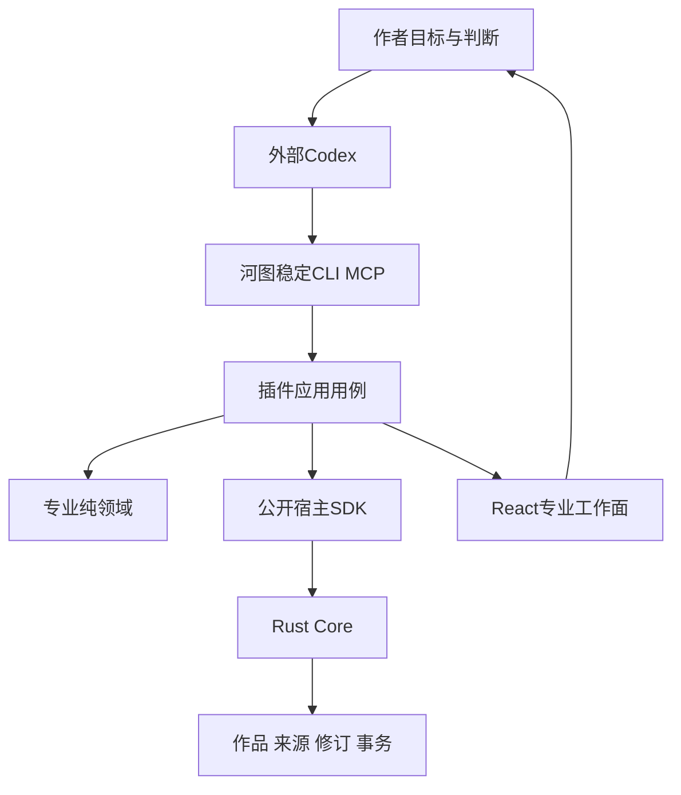

# 架构与技术选型

## 架构原则

宿主保持精炼稳定：作品、固定来源、候选、意见、作者决定及确定性事务归Core；本插件持有剧本杀工坊专业结构与算法。领域不依赖Electron、数据库、工具供应商或视图，应用层只依赖公开SDK，视图不直写Core文件。

## 技术选型

| 层 | 选择 | 原因 |
| --- | --- | --- |
| 领域 | TypeScript纯函数 | 可直接测试专业正反例，避免协议与算法缠绕 |
| 输入合同 | JSON Schema Draft-07、Ajv预编译 | 字段闭合、运行与机器发现一致 |
| 应用 | 公开SDK、ProjectStore | 复用固定引用、CAS和原键恢复 |
| 工作面 | React18、共享Radix语义样式 | 按专业内容渲染，跨系统共享Web层 |
| 构建 | 固定esbuild及TypeScript | 独立运行包、源码与许可可追踪 |
| 分发 | GitHub固定发行＋河图目录 | 包与宿主解耦，逐版本兼容验收 |

Cordis生命周期由宿主负责，本包使用apply／effect／invoke协议，不重新实现调度框架。相同JS/TS技术栈不表示原DSH包直接兼容。

## 专业取舍

本包是创作与线下试玩记录工具，不是线上游戏服务器或独立权限系统。玩家投影只返回选定角色可见资料；作者仍可使用主持视角。模拟试玩明确agent_simulated，不冒充真人反馈。发放只记录，不发送消息。正式人物、正文采纳和定稿归宿主；泄漏结构检查不判断文本自身是否暗示真相。

有限输入和预算优先于无界推演；确定性检查报告缺失前提，不伪装语义理解。无第二套作品权限、正文库、模型连接或内部生成循环。

## 风险与验收

格式损失、虚构前提、来源不足、并发修改和平台差异分别取证。实际机器、界面及发行归08；作者认可不能由算法通过代替。
