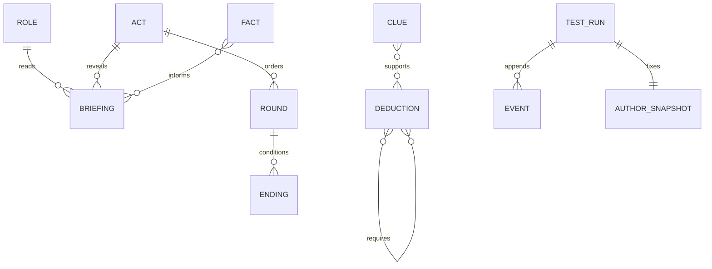
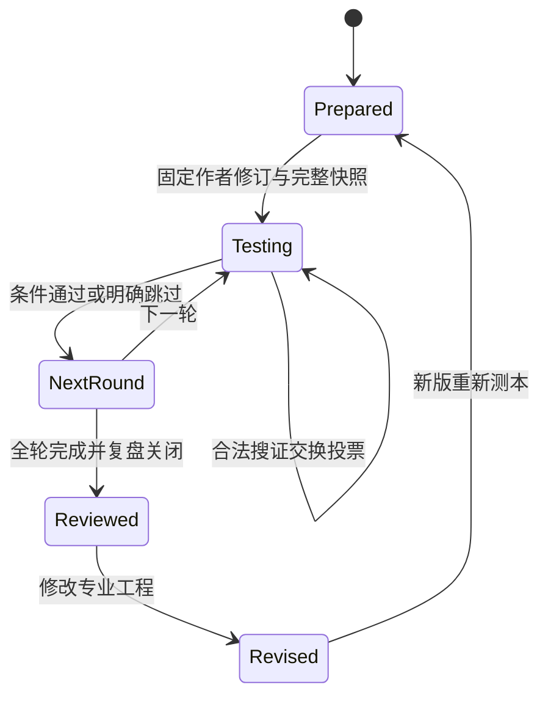
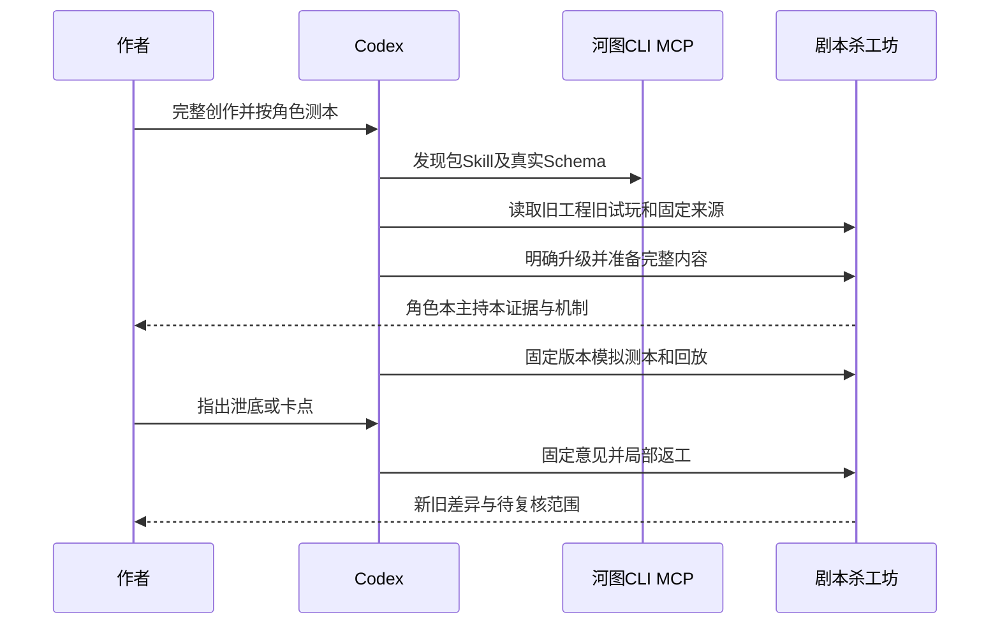

# 完整创作与机制测本

## 背景与目标

首版解决角色资料、分幕线索和固定试玩记录。完整剧本杀还需要说明案件如何发生、每人每幕读到什么、哪些证据支持哪一步推导、搜证交换怎样改变知情范围、投票如何收束，以及测本后怎样局部返工。每轮重新让模型推测这些关系，容易丢失旧依据与复盘上下文。

v0.2.0在原聚合增加可选depth.version=1。外部Agent负责创作与语义判断，软件保存结构、核验引用、计算机制事件并提供固定可见投影。声明证据齐备不表示诡计可行、推理公平或真人体验良好。

## 数据Owner与本体

| Owner | 事实与职责 |
| --- | --- |
| 宿主 | 作品、正式人物、固定来源、修订、CAS、原操作、候选及作者决定 |
| 本包 | 案件事实、角色分幕正文、证据推导、机制轮次、固定测本、结局条件和测本意见 |
| 悬疑推演台 | 独立推理工程，通过固定BasisRef组合 |
| 外部Agent与作者 | 创作、语义检查、解释卡点、取舍及定稿 |

- fact：声明的案件事实、时间顺序标签、相关人物及支持线索；程序不认证真实性。
- briefing：指定角色及幕次的完整正文、目标与知情事实；固定角色、幕次和所用事实的组合摘要。
- deduction：结论、理由、证据线索和前置推导；形成有向无环的声明推导图。
- clue_rule：明确线索是否可搜、可交换及搜证成本，与原clue按ID关联。
- round：幕次内有序的搜证、交换、投票或揭示轮次，明确预算、选项与必备线索。
- ending：依据指定投票轮次、选项和最少票数的候选结局；多个或没有满足条件时如实返回。
- test_run：固定完整作者快照、模拟或人工模式、角色标签及只追加事件。
- review：固定角色正文、推导或轮次的具体意见，保留摘要、原话与处理说明。

## 格式与兼容

根format_version及原roles、acts、clues、sessions保持。depth缺少时按v0.1.0语义读取；get不写入或迁移。enable_depth通过明确CAS建立空深度结构，旧sessions与snapshot保持逐字一致。旧试玩仍用原回放器，新机制测本进入depth.test_runs。

容器schema_version保持1.0.0，可选扩展以depth.version=1独立编号，兼容既有格式。本次不触发Core的跨Schema迁移；未来破坏性变更须走公开迁移合同。depth出现后，全量保存不得移除或降级；旧客户端裁掉扩展再覆盖须拒绝。案件事实、正文与机制可编辑，固定测本、事件和快照不能通过save_project伪造或改写。

集合、文本与递归均有预算：最多100个推导、1000个测本事件。局部ID唯一，引用存在，顺序在父幕内唯一；未知材料与模拟结果不补默认值。正式Schema与参数只以contracts/plugin-manifest.json为Owner，功能清单与operations由它生成。

## 机器动作

原动作和操作键语义保留，所有新增能力经同一plugins.invoke动态发现。

| 动作组 | 职责 |
| --- | --- |
| enable_depth | 显式升级当前工程，不改旧试玩 |
| put/remove fact、briefing、deduction、clue_rule、round、ending、review | 专业维护和依赖核验 |
| briefing_basis、deduction_basis、depth_target_digest | 当前组合摘要与显式复核依据 |
| check_depth、deduction_view | 覆盖、过期、证据可见及推导前提 |
| start_test | 固定完整作者快照和角色参与标签 |
| search_test_clue、share_test_clue、vote_test | 当前轮次原子事件 |
| advance_test_round、skip_test_round、close_test | 核验条件，或明确记录跳过原因，再完成复盘 |
| test_view、test_player_view | 固定回放与最小玩家投影 |
| export_depth_player、export_depth_gm、export_test_player | 分角色、主持及固定测本交付 |

写请求携带expected_revision、expected_sha256及原operation_key。未知先get_operation，同键异参拒绝；CAS冲突保留输入，读新基线和差异后再决定。

## 机制与信息可见

搜证先核对当前轮次、角色、线索幕次、可搜规则和剩余预算，全部通过才追加；失败不扣预算或发线索。公开线索给全体，私有线索按明确接收者发放。

交换须实际持有且规则允许；不能交换未知线索、给自己、重复接收或取未来材料。明确交换增加接收者，原发放历史保留。投票每人每轮一票，选项必须存在；未结束投票不在玩家投影暴露他人票。

必备线索或必需票未齐不能推进；skip_test_round须留下原因和未满足项，不记为通过。当前轮结束才进下一轮，全部轮次完成才能关闭；关闭后不可追加。回放核验顺序、外键、预算和每次转移。

玩家投影用白名单构造：背景、本人资料、已开放本人分幕正文、实际收到线索和本人状态。主持解答、事实全集、他人秘密、未来幕次及全工程JSON不进入投影。作者视角投影不构成真实玩家身份认证；文本本身是否泄底仍由Agent与真人核对。

## 工作面与接续

五页中增加整案阅读、角色分幕选择、证据链、机制轮次、固定测本与具体意见。每名角色每幕全文均可阅读，不只看Agent摘要。Agent准备完整结构，作者不重复填表。正常业务无需打开GUI。

create_handoff返回固定专业BasisRef。经公开资料任务保存派生快照，再进入宿主真实参考稿任务并回读完整字节；原正文保持，采纳和定稿独立。

## 完整验收

| 用例 | 正向 | 反向与边界 |
| --- | --- | --- |
| 旧工程 | 显式升级，旧试玩逐字保持 | get无写入，depth不能被裁掉覆盖 |
| 角色正文 | 两幕多角色全文与知情范围 | 错人物错幕拒绝；未来知情待检查 |
| 证据推导 | 多级前提和证据可追踪 | 悬空与循环拒绝；不足如实返回 |
| 局部返工 | 改事实后旧正文及意见过期 | 不重签、不改其他角色正文 |
| 搜证 | 成功后按明确成本扣预算 | 不足、错幕、不可搜均不写事件 |
| 交换 | 持有且可交换才增加接收者 | 未知、不可分享、重复接收拒绝 |
| 投票结局 | 每人一票，列出全部匹配结局 | 非法选项拒绝，平票不随意裁定 |
| 轮次 | 条件齐备推进或明确跳过 | 缺票缺线索不冒充通过 |
| 固定历史 | 改稿后旧回放与投影保持 | JSON不能改写快照或伪造事件 |
| 复盘 | 关闭后按具体卡点修改新版 | 模拟不冒充真人，关闭后不可写 |
| 全端 | 单元、应用、全动作、生命周期、Skill、CLI/MCP、Codex、Electron | 各层分别取证，专业体验另验 |

实际界面覆盖浅暗1360／760、键盘、角色幕次选择、空错误、原字节交付、取消、冲突与关闭恢复；公开包重下载核验双摘要，官网中英指南对应实际版本。实施状态唯一Owner为08。
